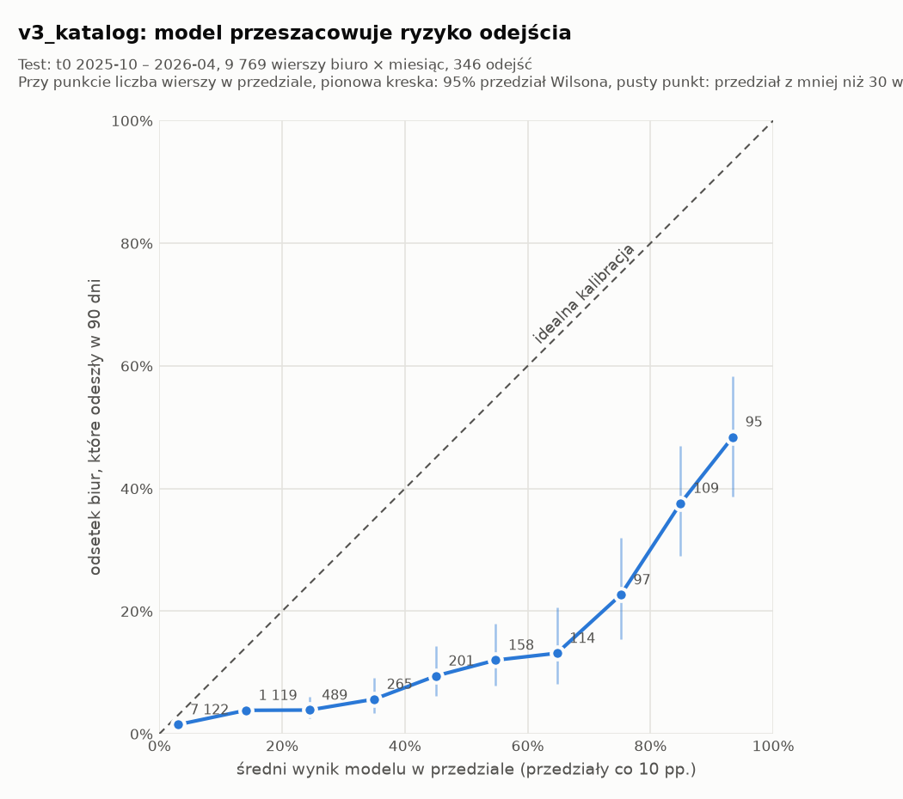
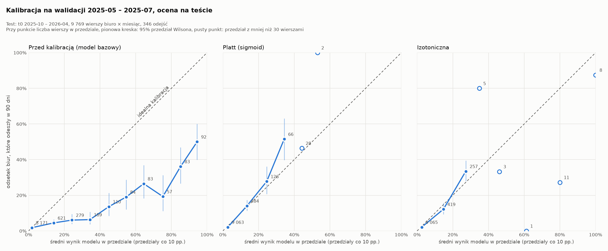

# Kalibracja v3_katalog: czy wynik modelu to prawdopodobieństwo

**Nie.** Wynik v3_katalog nie jest prawdopodobieństwem odejścia. Model przeszacowuje ryzyko w każdym przedziale wyniku,
średnio 3,1 razy (średni wynik 11,1%, a odchodzi 3,5% biur). Gdy model mówi 30–40%, odchodzi 5,7% biur, czyli co
osiemnaste, a nie co trzecie. Dlatego wyniku v3 nie wolno podstawiać jako p do wzoru p × s × V − C
([macierz_wartosci.md](../../../../../docs/macierz_wartosci.md)) bez ponownej kalibracji.

**Próg 0,5 na snapszocie 2026-04-01 wybiera 84 z 1 401 biur.** Odeszło z nich 20 (23,8%). Średni wynik wybranych to
71,4%, więc według modelu powinno ich odejść około 60.

**Wybieramy kalibrację Platta** (sekcje 5 i 6). Kalibrator uczony na walidacji 2025-05 – 2025-07 daje na teście
średni wynik 4,0% przy 3,5% odejść i to samo AUC 0,789 co model przed kalibracją. Brier na teście: Platt 0,0304,
izotoniczna 0,0307, stała prognoza 3,5% dla każdego biura 0,0342. Obie metody są lepsze od stałej, a różnica między
nimi mieści się w szumie. O wyborze decyduje to, że kalibracja uczyła się na odejściach tylko 87 biur. Tyle wystarcza
Plattowi (2 parametry), ale nie izotonicznej, która na górze skali daje biurom wynik 100%. Przy progu opłacalności
0,174 Platt wybiera na 2026-04-01 33 biura, z których odeszło 17.

## 1. Jak liczone

| | |
|---|---|
| Model | zapisany artefakt `versions/v3_katalog/artefakty/model.joblib`, bez ponownego uczenia (`class_weight="balanced"`) |
| Zbiór testowy | ten sam co w [v3_katalog.md](v3_katalog.md): `cechy_treningowe`, t0 2025-10 – 2026-04, wszystkie miesięczne wiersze. 9 769 wierszy biuro × miesiąc, 346 odejść (3,5%). Model uczył się na t0 do 2025-07 |
| Próg | wynik ≥ 0,5 na wierszach z t0 = 2026-04-01. Etykieta `odejdzie_90d` (okno do 2026-06-30) jest kompletna |
| Kalibracja | 10 przedziałów wyniku o równej szerokości: [0; 0,1), [0,1; 0,2), …, [0,9; 1]. W każdym liczę średni wynik modelu i odsetek wierszy z `odejdzie_90d = 1` |
| Przedziały 95% | Wilson dla odsetka w przedziale. Biuro występuje w teście do 7 razy (co miesiąc), a przedziały traktują wiersze jak niezależne, więc są trochę za wąskie |
| Kod | `api/ai/churn_model/kalibracja.py`; wyniki w `evals/kalibracja.json`, `evals/kalibracja.png` i `evals/kalibracja_przed_po.png` |

```bash
PYTHONPATH=api poetry run python -m api.ai.churn_model.kalibracja
```

## 2. Próg 0,5 na snapszocie 2026-04-01

| | Biura |
|---|---:|
| wszystkie biura w snapszocie | 1 401 |
| odeszły w 90 dni | 49 |
| **wybrane przy progu 0,5** | **84** |
| wybrane, które odeszły | 20 |
| precyzja / czułość | 23,8% / 40,8% |
| średni wynik modelu wśród wybranych | 71,4% (oczekiwane ≈ 60 odejść) |
| suma wyników modelu w snapszocie | 161,2 (oczekiwane odejścia według modelu; faktycznie 49) |

Na pozostałych snapszotach testu próg 0,5 wybiera od 62 (2026-03) do 93 (2026-01) biur, z czego odchodzi 17–22. To
więcej niż budżet 60 wizyt na kwartał z `retention_bc/zalozenia.yaml`.

Próg 0,5 to domyślny próg klasyfikatora i nie wynika z ekonomii wizyty. Próg opłacalności z macierzy wartości
(p > 0,174) na surowym wyniku v3 wybrałby 267 biur w tym snapszocie. Większość z nich ma rzeczywiste ryzyko poniżej
0,174 (tabela niżej).

## 3. Wykres kalibracji (zbiór testowy)



| Przedział wyniku | Wiersze | Średni wynik | Odejścia | Odsetek odejść | 95% przedział |
|---|---:|---:|---:|---:|---|
| 0,0–0,1 | 7 122 | 3,0% | 107 | 1,5% | 1,2–1,8% |
| 0,1–0,2 | 1 119 | 14,1% | 43 | 3,8% | 2,9–5,1% |
| 0,2–0,3 | 489 | 24,4% | 19 | 3,9% | 2,5–6,0% |
| 0,3–0,4 | 265 | 35,0% | 15 | 5,7% | 3,5–9,1% |
| 0,4–0,5 | 201 | 45,1% | 19 | 9,5% | 6,1–14,3% |
| 0,5–0,6 | 158 | 54,8% | 19 | 12,0% | 7,8–18,0% |
| 0,6–0,7 | 114 | 64,8% | 15 | 13,2% | 8,1–20,6% |
| 0,7–0,8 | 97 | 75,2% | 22 | 22,7% | 15,5–32,0% |
| 0,8–0,9 | 109 | 84,9% | 41 | 37,6% | 29,1–47,0% |
| 0,9–1,0 | 95 | 93,4% | 46 | 48,4% | 38,6–58,3% |
| **razem** | **9 769** | **11,1%** | **346** | **3,5%** | |

- **Cała krzywa leży pod przekątną.** Żaden przedział nie obejmuje swojego średniego wyniku. Nawet w najniższym
  przedziale model mówi 3,0%, a odchodzi 1,5%.
- **Ranking działa.** Odsetek odejść rośnie z wynikiem: od 1,5% w najniższym do 48% w najwyższym przedziale (AUC
  0,783). Przedziały 0,1–0,2 i 0,2–0,3 mają ten sam odsetek 3,8–3,9%, więc w tym zakresie model słabo różnicuje
  biura.
- **Brier score 0,052** to więcej niż 0,034 dla stałej prognozy „każde biuro 3,5%”. Jako prawdopodobieństwa wyniki v3
  są gorsze niż sam odsetek odejść.
- Rzeczywisty odsetek odejść przekracza próg opłacalności 17,4% dopiero od przedziału 0,7–0,8.
- 73% wierszy wpada do przedziału 0,0–0,1, a w przedziałach od 0,5 jest ich po 95–158. Punkty z prawej strony
  wykresu mają więc szerokie przedziały, ale nawet ich górne granice leżą daleko pod przekątną.

## 4. Skąd to się bierze

`class_weight="balanced"` waży każde odejście w uczeniu odwrotnie do częstości klasy. Odchodzi 3,6% wierszy
uczących, więc odejście waży około 27 razy więcej niż pozostanie (21 048 / 779). Model uczy się na danych, w których
odejść jest „po równo” z pozostaniami, i zawyża prawdopodobieństwo. To samo widać w
[v3_katalog.md](v3_katalog.md): bez wag AUC rośnie z 0,783 do 0,801, więc wagi nie pomagają nawet rankingowi.

## 5. Kalibracja Platta i izotoniczna

### Jak liczone

| | |
|---|---|
| Walidacja | ostatnie 3 miesiące uczenia v3 przed przerwą: t0 2025-05 – 2025-07, 4 141 wierszy (1 414 biur), 162 wiersze z odejściem (3,9%), czyli 87 różnych biur (sekcja 6) |
| Model bazowy | Pipeline v3 (`zbuduj_pipeline()`, `class_weight="balanced"`) uczony od nowa bez walidacji. Artefakt v3 widział miesiące walidacji, a kalibrator musi się uczyć na wierszach, których model nie widział. Uczenie na t0 2024-04 – 2025-01 (13 573 wiersze, 483 odejścia): okno etykiety [t0, t0 + 90 dni) kończy się przed 2025-05-01. To ta sama zasada co foldy w `v3_katalog/trenuj.py`. Bez niej etykiety z lutego – kwietnia 2025 opisywałyby te same odejścia co walidacja |
| Kalibratory | `CalibratedClassifierCV(FrozenEstimator(bazowy), method=...)` uczony na walidacji. `sigmoid` (Platt) dostaje surowy wynik LightGBM (`decision_function`, czyli logit p): 2 parametry. `isotonic`: schodkowa funkcja niemalejąca |
| Ocena | ten sam test co wyżej (t0 2025-10 – 2026-04, 9 769 wierszy, 346 odejść), te same 10 przedziałów. Próg opłacalności C / (s × V) = 0,1736 jest czytany z `retention_bc/zalozenia.yaml` |
| Wykres | panel „przed” to model bazowy, a nie artefakt v3 (ten jest w sekcji 3), bo kalibrator przekształca wyniki modelu bazowego. Przedziały z mniej niż 30 wierszami są pustymi punktami bez linii |

### Wykresy kalibracji przed i po



### Wyniki na teście

| | v3_katalog (artefakt) | Model bazowy, przed | Platt | Izotoniczna |
|---|---:|---:|---:|---:|
| AUC | 0,783 | 0,789 | 0,789 | 0,776 |
| Brier (stała prognoza 3,9% z walidacji: 0,034) | 0,052 | 0,042 | **0,030** | 0,031 |
| log loss (stała prognoza: 0,153) | 0,192 | 0,165 | **0,127** | 0,141 |
| średni wynik (odchodzi 3,5%) | 11,1% | 7,4% | 4,0% | 4,0% |
| najwyższy wynik | 98,0% | 99,0% | 55,7% | 100% |
| suma wyników na 2026-04-01 (odeszło 49) | 161,2 | 101,5 | 54,0 | 52,9 |
| wybrane przy progu 0,5 na 2026-04-01 / odeszły | 84 / 20 | 49 / 21 | 0 | 0 |
| wybrane przy progu 0,174 na 2026-04-01 / odeszły | 267 / 30 | 167 / 25 | **33 / 17** | 56 / 21 |
| wynik wizyt według macierzy: odeszłe × s × V − wybrane × C | −118 692 zł | −28 980 zł | +81 799 zł | +81 850 zł |

Ostatni wiersz to ilustracja na jednym snapszocie. Zakłada, że wizyta zatrzymałaby 30% wybranych biur, które
odeszły (s z macierzy), i że każda wizyta kosztuje C = 1 260 zł.

Kalibracja w przedziałach z co najmniej 30 wierszami (średni wynik → faktyczny odsetek odejść, w nawiasie liczba
wierszy):

| Przedział | Platt | Izotoniczna |
|---|---|---|
| 0,0–0,1 | 2,8% → 2,1% (9 063) | 2,6% → 2,1% (9 065) |
| 0,1–0,2 | 13,5% → 14,0% (484) | 14,8% → 12,2% (419) |
| 0,2–0,3 | 24,6% → 27,8% (126) | 27,3% → 33,5% (257) |
| 0,3–0,4 | 34,4% → 51,5% (66; 95% 39,7–63,2%) | 5 wierszy |
| od 0,4 | 30 wierszy | 23 wiersze, w tym 8 z wynikiem 100% (7 odeszło) |

- **Platt** leży blisko przekątnej do wyniku 30%. W przedziale 0,3–0,4 zaniża ryzyko: mówi 34%, a odchodzi 52%. Na
  liście wizyt to nic nie zmienia, bo te biura i tak są daleko ponad progiem 0,174, a kolejność biur jest ta sama co
  przed kalibracją (to samo AUC).
- **Izotoniczna** ma podobną średnią, ale jej krzywa ma 36 schodków zbudowanych z odejść 87 biur. 9 769 wierszy
  testu dostaje tylko 62 różne wyniki, więc AUC spada o 0,013, a 8 biur dostaje 100%, choć jedno z nich zostało. Wynik
  100% we wzorze p × s × V − C oznacza pewne odejście, czego żaden model nie powinien obiecywać.
- Obie metody przy niskich wynikach lekko przeszacowują ryzyko (2,6–2,8% wobec 2,1%). Na walidacji odchodziło 3,9%
  biur, a na teście 3,5%. Kalibrator przenosi poziom odejść z okresu, na którym się uczył.
- Po kalibracji próg 0,5 nie wybiera żadnego biura. Próg opłacalności wybiera 33 (Platt) albo 56 (izotoniczna) biur,
  czyli tyle, ile mieści budżet 60 wizyt na kwartał.

## 6. Platt czy izotoniczna

### Brier score na teście

Brier score to średni kwadrat pomyłki prognozy. Jeśli biuro odeszło (1), a model dał mu 30%, pomyłka wynosi
(1 − 0,3)² = 0,49. Jeśli zostało (0) przy 30%, pomyłka wynosi 0,3² = 0,09. Wynik to średnia z 9 769 wierszy testu.
Im mniej, tym lepiej. Punkt odniesienia to prognoza bez modelu: każde biuro dostaje 3,5%.

| Prognoza | Brier | Różnica względem stałej 3,5% (95% przedział) |
|---|---:|---|
| stała 3,5% dla każdego biura | 0,0342 | — |
| model bazowy przed kalibracją | 0,0424 | +0,0083 (gorzej niż bez modelu) |
| izotoniczna | 0,0307 | −0,0035 (−0,0053…−0,0018) |
| **Platt** | **0,0304** | **−0,0038 (−0,0054…−0,0023)** |

Platt − izotoniczna: −0,0003, 95% przedział −0,0009…+0,0002. Przedziały to bootstrap po biurach testu (1 000
losowań, ziarno 42).

- Obie metody są wyraźnie lepsze od stałej prognozy: o około 10%, a przedział różnicy nie obejmuje zera. Bez
  kalibracji model jest gorszy od stałej.
- Stała 3,5% to wymagający punkt odniesienia, bo zna z góry odsetek odejść na teście. W dniu decyzji go nie znamy:
  stała z walidacji (3,9%) daje ten sam Brier 0,0342.
- **Między Plattem a izotoniczną na teście nie ma rozstrzygnięcia.** Platt jest lepszy o 0,0003, ale przedział
  różnicy obejmuje zero. Sam Brier nie wskazuje metody.

### Ile odejść widziała kalibracja

| | |
|---|---:|
| wiersze walidacji (biuro × miesiąc, t0 2025-05 – 2025-07) | 4 141 |
| biura w walidacji | 1 414 |
| wiersze z odejściem | 162 (54 / 58 / 50 w kolejnych miesiącach) |
| **różne biura, które odeszły** | **87** |

162 wiersze to nie 162 odejścia. Okno etykiety ma 90 dni, więc biuro, które odeszło, ma etykietę 1 w kilku kolejnych
snapszotach: 29 biur w jednym, 41 w dwóch, a 17 we wszystkich trzech. Kalibrator uczy się więc z historii 87 biur.

### Czy wynik zależy od tego, które biura trafiły do walidacji

Każdą metodę nauczyłem 200 razy na losowaniu biur z walidacji (ze zwracaniem, ziarno 42) i za każdym razem
oceniłem na całym teście:

| | Platt | Izotoniczna |
|---|---:|---:|
| Brier na teście, mediana | 0,0304 | 0,0309 |
| Brier, 95% losowań | 0,0302–0,0311 | 0,0303–0,0315 |
| Brier, najgorsze losowanie | 0,0316 | 0,0319 |
| najwyższy wynik, mediana | 56% | 100% |
| losowania, w których jakieś biuro dostaje 100% | 0% | 98% |

Platt wypada lepiej w 82,5% losowań. Żadne losowanie nie daje żadnej z metod wyniku gorszego niż stała 3,5%.

### Dlaczego Platt

- **Platt ustawia tylko dwie liczby:** o ile obniżyć wyniki modelu i jak bardzo je ścisnąć. Kształt krzywej bierze
  z modelu. Do ustawienia dwóch liczb odejścia 87 biur wystarczą, a wynik prawie się nie zmienia, gdy wylosujemy inne
  biura.
- **Izotoniczna sama rysuje kształt krzywej,** tu z 36 schodków. Na jeden schodek przypadają średnio 2–3 biura, które
  odeszły. Na górze skali o wyniku decyduje kilka biur, więc metoda prawie zawsze (w 98% losowań) uznaje któreś biuro
  za pewne odejście (100%). We wzorze p × s × V − C to najwyższa możliwa wartość wizyty, a na teście jedno z 8 takich
  biur zostało.
- **Na teście obie metody wypadają tak samo** (różnica Briera w szumie). Przy takim samym wyniku wybieramy metodę
  prostszą i mniej zależną od przypadku, czyli Platta. Platt dodatkowo zachowuje kolejność biur (AUC 0,789, a
  izotoniczna 0,776).
- Izotoniczną warto sprawdzić jeszcze raz, gdy walidacja będzie miała wyraźnie więcej odejść niż 87 biur, np. przy
  dłuższym okresie walidacji.

## 7. Wniosek

- Surowy wynik v3_katalog nie nadaje się do liczenia zysku z wizyty. Można go używać tylko do kolejności biur, a nie
  jako p we wzorze p × s × V − C.
- Próg 0,5 nie ma uzasadnienia ekonomicznego. Na surowym wyniku wybiera więcej biur (84), niż pozwala budżet wizyt
  (60 na kwartał), a po kalibracji nie wybiera żadnego.
- **Wybór: kalibracja Platta.** Brier taki jak izotonicznej i lepszy od stałej 3,5%, ale stabilny przy odejściach
  tylko 87 biur w walidacji, bez wyników 100% i bez zmiany kolejności biur.
- **Wersja `v4_skalibrowany`** (aktywna w `current.yaml`, run w MLflow, wiersz w [porownanie.md](porownanie.md)) to
  dokładnie model zmierzony tutaj: model bazowy uczony do 2025-01 + Platt. `versions/v4_skalibrowany/trenuj.py`
  sprawdza, że kalibracja nie zmieniła kolejności: 0 z 9 769 wierszy testu zmienia rangę, AUC przed i po wynosi
  0,789. Kolejność v4 różni się jednak od v3_katalog (korelacja rang 0,72, w top 60 na 2026-04-01 wspólne 37 biur),
  bo model bazowy uczy się na krótszym okresie. To skutek wydzielenia walidacji, a nie kalibracji.
- Do sprawdzenia: model uczony na całym okresie uczenia + kalibrator z tej walidacji. Ma więcej danych, ale kalibrator
  byłby dopasowany do innego modelu, więc trzeba go osobno sprawdzić tym samym wykresem.
- Osobno warto sprawdzić v3 bez `class_weight`: AUC 0,801 już zmierzone, kalibracji jeszcze nie.
