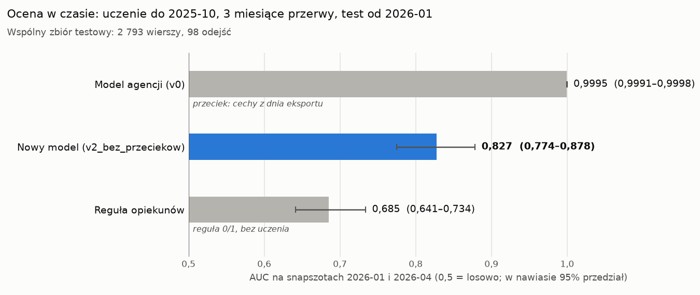

# Ocena w czasie: v0_agencja, v2_bez_przeciekow i reguła opiekunów

Uczenie na starszych snapszotach, test na snapszotach od 2026-01. Na wspólnym zbiorze testowym **v2 ma AUC 0,827
(95%: 0,774–0,878)**, reguła opiekunów **0,685 (0,641–0,734)**, a model agencji nadal **0,9995**. Ten ostatni wynik to
przeciek, a nie jakość prognozy: model agencji ma cechy z dnia eksportu, więc w produkcji takiego AUC nie osiągnie.



## 1. Jak liczone

| | |
|---|---|
| Test | snapszoty od 2026-01-01 |
| Uczenie | snapszoty `d`, których okno etykiety `[d, d + 90 dni)` kończy się przed 2026-01-01. Ostatni taki snapszot to 2025-10-01, więc między uczeniem a testem są 3 miesiące przerwy, a żadna etykieta uczenia nie korzysta ze zdarzeń z okresu testu |
| Wspólny zbiór testowy | wiersze agencji ze snapszotów 2026-01 i 2026-04: **2 793 wiersze, 98 odejść**. Model agencji da się ocenić tylko tam, gdzie agencja dała cechy |
| v0_agencja | uczony na wierszach agencji (kwartalnych) 2024-04 – 2025-10: 7 snapszotów, 9 553 wiersze, 338 odejść |
| v2_bez_przeciekow | uczony na wszystkich miesięcznych snapszotach 2024-01 – 2025-10 (`snapshoty` + `ai/features/cechy_snapszotu.sql`): 22 snapszoty, 29 994 wiersze, 1 042 odejścia. Kod i parametry jak w `versions/v2_bez_przeciekow/` |
| regula_opiekunow | bez uczenia; cechy z `versions/regula_opiekunow/cechy.sql` |
| Przedział 95% | bootstrap: 1 000 losowań biur ze zwracaniem, bo to samo biuro jest w kilku snapszotach testu |
| Precyzja przy K | trafienia wśród K wierszy z najwyższym wynikiem, gdzie K = liczba wierszy oznaczonych przez regułę |
| Kod | `ocena_w_czasie.py`; wyniki w `evals/ocena_w_czasie.json`, wykres `evals/ocena_w_czasie.png` |

```bash
PYTHONPATH=api poetry run python -m api.ai.churn_model.ocena_w_czasie
```

## 2. Wyniki

**Wspólny zbiór testowy** (2026-01 i 2026-04; 2 793 wiersze, 98 odejść; K = 84):

| Model | AUC | 95% przedział | Trafione w top 84 | Precyzja | Czułość |
|---|---:|---|---:|---:|---:|
| v0_agencja (przeciek) | 0,9995 | 0,9991–0,9998 | 81 | 96,4% | 82,7% |
| **v2_bez_przeciekow** | **0,827** | 0,774–0,878 | 36 | 42,9% | 36,7% |
| regula_opiekunow | 0,685 | 0,641–0,734 | 38 | 45,2% | 38,8% |
| v2, uczony tylko na wierszach agencji (kontrola) | 0,865 | 0,825–0,903 | 40 | 47,6% | 40,8% |

**Wszystkie miesięczne snapszoty testu** (2026-01 – 2026-06; 8 404 wiersze, 295 odejść; K = 282):

| Model | AUC | 95% przedział | Trafione w top 282 | Precyzja | Czułość |
|---|---:|---|---:|---:|---:|
| **v2_bez_przeciekow** | **0,787** | 0,741–0,830 | 94 | 33,3% | 31,9% |
| regula_opiekunow | 0,671 | 0,628–0,710 | 107 | 37,9% | 36,3% |

## 3. Co z tego wynika

- **v2 porządkuje biura wyraźnie lepiej niż reguła:** 0,827 wobec 0,685 na wspólnym teście i 0,787 wobec 0,671 na
  pełnym teście miesięcznym. Przedziały się nie pokrywają.
- **Na samej górze listy v2 nie jest lepszy od reguły.** Przy tej samej liczbie oznaczonych biur v2 trafia 36 odejść, a
  reguła 38 (różnica w granicach szumu). Na pełnym teście miesięcznym reguła trafia 107, a v2 94. Jeśli opiekunowie
  mają obsłużyć tyle biur, ile oznacza reguła, v2 jeszcze jej nie zastąpi. Wygrywa dopiero przy innych progach.
- **Wynik v2 jest stabilny między sposobami oceny:** 0,812 przy losowym podziale agencji, 0,799 przy poprzednim
  podziale w czasie i 0,827 tutaj. Model agencji ma 0,9995 niezależnie od podziału, bo wynik daje mu przeciek.
- **Otwarte pytanie: kalendarz snapszotów.** v2 uczony tylko na kwartalnych wierszach agencji ma 0,865, czyli więcej
  niż uczony na wszystkich miesiącach (0,827), choć ma 3 razy mniej danych. Różnica jest istotna (bootstrap
  parowany: +0,007 do +0,068). v2 uczony na miesięcznych snapszotach, ale tylko ze stycznia, kwietnia, lipca i
  października (tych samych miesięcy co test), ma 0,860. Wynik zależy więc od tego, z których miesięcy pochodzą
  snapszoty uczące, a nie od samych wierszy agencji. Przyczyny jeszcze nie znam. Główny wariant zostaje ten
  zaplanowany przed oceną (wszystkie starsze miesiące), bo wybór wariantu po wyniku na teście zawyżyłby ocenę. Do
  sprawdzenia na zbiorze walidacyjnym, a nie na tym teście: sezonowość cech miesięcznych (np. faktur na koniec
  miesiąca, rocznic) i cecha „miesiąc snapszotu”.
