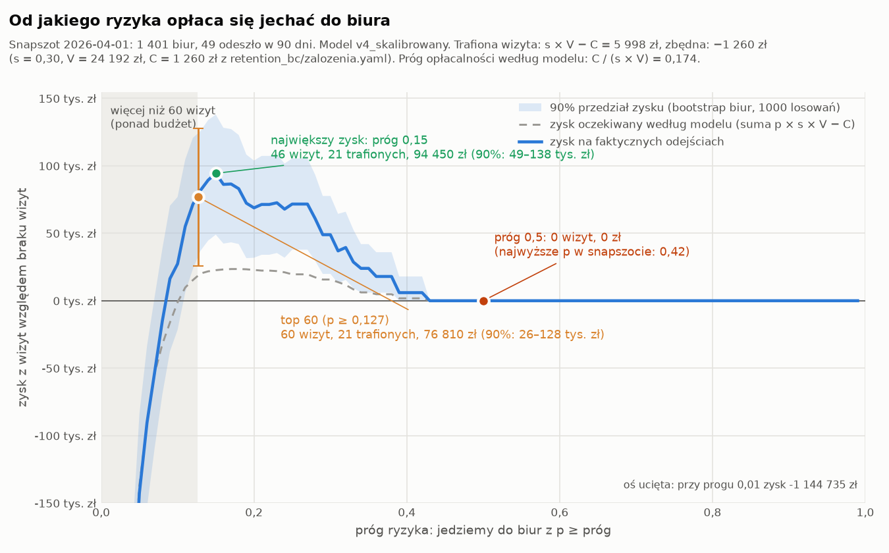
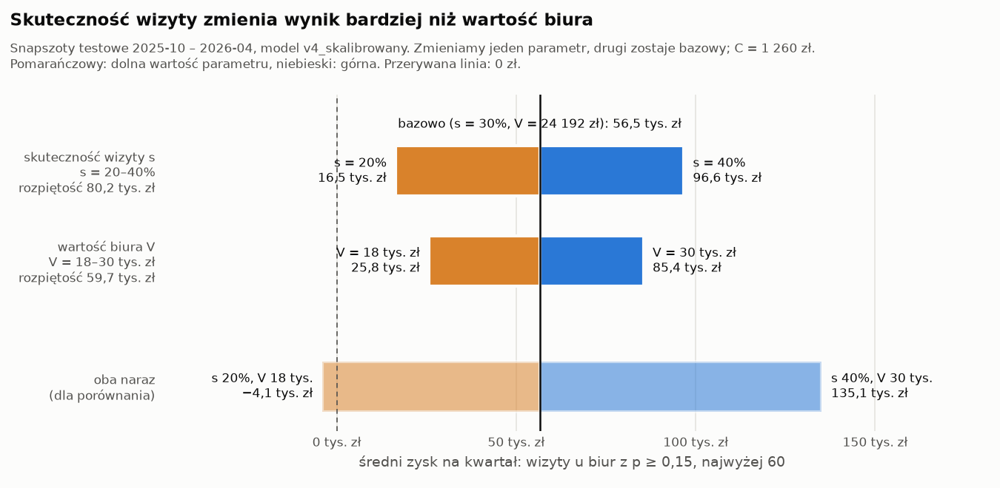

# Próg ryzyka: od jakiego p opłaca się jechać do biura

Pytanie sprzedaży: od jakiego ryzyka odejścia opłaca się wysłać opiekuna do biura. Dla każdego progu od 0,01 do
0,99 liczę, ile zarobilibyśmy na wizytach u biur z p ≥ próg na snapszocie **2026-04-01**. Używam faktycznych odejść
w kolejnych 90 dniach i macierzy wartości ([macierz_wartosci.md](macierz_wartosci.md)):

- **trafiona wizyta** (biuro odeszło): s × V − C = 0,30 × 24 192 − 1 260 = **+5 997,60 zł**;
- **zbędna wizyta** (biuro i tak zostało): −C = **−1 260 zł**;
- brak wizyty: 0 zł.

s, V, C i budżet 60 wizyt na kwartał pochodzą z [`retention_bc/zalozenia.yaml`](../retention_bc/zalozenia.yaml).
p to prognoza aktywnego modelu churnu, **v4_skalibrowany** (`api/api/ai/churn_model/current.yaml`). Snapszot
2026-04-01 należy do części testowej v4 (uczenie na t0 do 2025-07), więc model nie widział jego etykiet. Snapszot
ma 1 401 biur, z których 49 odeszło w 90 dni.

## Krzywa wartości



Niebieska linia pokazuje zysk na faktycznych odejściach. Niebieskie pasmo to 90% przedział tego zysku. Szara
przerywana linia to zysk oczekiwany według samego modelu (suma p × s × V − C po odwiedzonych biurach). Szare pole
obejmuje progi, przy których wizyt jest więcej niż 60.

**Przedział 90%** pochodzi z bootstrapu: 1 000 razy losuję 1 401 biur snapszotu ze zwracaniem (ziarno 42) i liczę
zysk przy każdym progu. Granice przedziału to 5. i 95. percentyl. Dla top 60 w każdym losowaniu biorę od nowa
60 biur z najwyższym p (pionowa kreska przy punkcie top 60).

| Wariant | Wizyty | Trafione | Zbędne | Zysk | 90% przedział zysku |
|---|---:|---:|---:|---:|---:|
| **Próg 0,5** | 0 | 0 | 0 | **0 zł** | 0 – 0 zł |
| **Top 60** (60 biur z najwyższym p, czyli p ≥ 0,127) | 60 | 21 | 39 | **76 809,60 zł** | 26 006 – 127 613 zł |
| **Próg 0,15** (największy zysk) | 46 | 21 | 25 | **94 449,60 zł** | 48 974 – 137 995 zł |
| Próg 0,174 (C / (s × V), opłacalność według modelu) | 33 | 17 | 16 | 81 799,20 zł | 42 034 – 122 873 zł¹ |
| Próg 0,01 (prawie wszyscy) | 1 185 | 48 | 1 137 | −1 144 735,20 zł | −1 224 952 – −1 060 164 zł |

¹ Przedział dla progu 0,18 z siatki. Na tym snapszocie progi 0,174 i 0,18 wybierają prawie te same biura (33 i 32).

## Wnioski

1. **Próg 0,5 nie wybiera żadnego biura.** Najwyższe p w snapszocie wynosi 0,42. Po kalibracji v4 zwraca
   prawdopodobieństwo odejścia (średnie p na tym snapszocie to 3,9%), więc „ponad 50%” prawie się nie zdarza.
   Taki próg oznacza rezygnację z wizyt i z ok. 77–94 tys. zł na kwartał.
2. **Wizyta zaczyna się opłacać od p ≈ 0,15–0,18.** Na 2026-04-01 największy zysk daje próg 0,15. Zysk
   oczekiwany według modelu jest największy przy 0,18, co zgadza się z teoretycznym C / (s × V) = 0,174. Krzywa
   jest płaska: każdy próg od 0,13 do 0,27 daje co najmniej 67 889 zł, więc dokładne położenie maksimum to w dużej
   mierze szum.
3. **Top 60 przekracza próg opłacalności.** Biura od 47. do 60. mają p między 0,127 a 0,15. Wśród tych
   14 wizyt nie ma żadnej trafionej, więc kosztują 17 640 zł. Budżet 60 wizyt warto traktować jako górny limit,
   a nie jako cel do wykorzystania.
4. **Poniżej ok. 0,09 wizyty przynoszą stratę.** Przy p ≥ 0,05 jest 286 wizyt i −142 632 zł, a przy p ≥ 0,01
   1 185 wizyt i −1,14 mln zł.

## Jak pewny jest ten próg

**Bootstrap biur na 2026-04-01.**

- **Dolna granica przedziału jest powyżej zera przy każdym progu od 0,11 do 0,38.** W płaskiej części krzywej
  (0,13 – 0,27) wynosi co najmniej 31 586 zł. Wizyty u tych biur opłacają się niezależnie od tego, które biura
  akurat odeszły. Przy progu 0,10 i niższym przedział obejmuje już straty (przy 0,10: −21 571 – 76 926 zł).
- **Najlepszy próg w losowaniach** ma medianę 0,15, a jego 90% przedział to 0,15 – 0,25.
- **Próg 0,15 wypada lepiej niż top 60 w 99,1% losowań.** 90% przedział różnicy to 3 780 – 27 720 zł. Próg 0,15
  wybrałem jednak na tych samych danych, więc ta różnica jest zawyżona. Na pozostałych snapszotach (tabela niżej)
  top 60 i próg 0,174 dają prawie ten sam łączny zysk. Różnica między progiem 0,18 a top 60 ma przedział
  −20 563 – 28 995 zł, więc nie wiadomo, który z nich jest lepszy.
- Bootstrap obejmuje tylko losowość biur w jednym snapszocie. Nie obejmuje niepewności modelu, zmian między
  miesiącami ani niepewności s, V i C. Te opisują części o innych snapszotach i o wrażliwości na założenia.

**Zysk na odejściach jest ok. 4× wyższy niż zysk oczekiwany.** Wśród 46 biur z p ≥ 0,15 model spodziewał się ok.
11 odejść (suma p), a odeszło 21. Na tym snapszocie v4 zaniża ryzyko najbardziej zagrożonych biur. Przez to niższe
progi opłacają się bardziej, niż wynika ze wzoru. Na jednym snapszocie z 49 odejściami może to być przypadek.

**Najlepszy próg na innych snapszotach testowych v4.** Rachunek jest ten sam, zysk w zł:

| Snapszot | Biura | Odejścia | Najlepszy próg | Wizyty | Trafione | Zysk | Zysk przy 0,174 | Top 60: trafione | Top 60: zysk |
|---|---:|---:|---:|---:|---:|---:|---:|---:|---:|
| 2025-10-01 | 1 387 | 50 | 0,14 | 62 | 21 | 74 290 | 59 724 | 19 | 62 294 |
| 2025-11-01 | 1 389 | 50 | 0,11 | 82 | 22 | 56 347 | 56 246 | 18 | 55 037 |
| 2025-12-01 | 1 403 | 54 | 0,29 | 21 | 9 | 38 858 | 32 609 | 15 | 33 264 |
| 2026-01-01 | 1 393 | 49 | 0,15 | 62 | 18 | 52 517 | 44 604 | 17 | 47 779 |
| 2026-02-01 | 1 399 | 48 | 0,18 | 35 | 14 | 57 506 | 52 466 | 17 | 47 779 |
| 2026-03-01 | 1 397 | 46 | 0,13 | 50 | 19 | 74 894 | 54 029 | 19 | 62 294 |
| **2026-04-01** | 1 401 | 49 | **0,15** | 46 | 21 | 94 450 | 81 799 | 21 | 76 810 |

- **Najlepszy próg mieści się w 0,11–0,29**, a w 5 z 7 snapszotów w 0,13–0,18. Na żadnym snapszocie najlepszy
  próg nie jest wyższy niż 0,3.
- **Próg 0,174 i top 60 dają na 7 snapszotach prawie ten sam łączny zysk**: odpowiednio 381 478 zł i 385 258 zł.
  Raz wygrywa jeden wariant, raz drugi. Oba są na plusie na każdym snapszocie, a próg 0,5 zawsze daje 0 zł.
- Na 2 snapszotach najlepszy próg wymaga więcej niż 60 wizyt (62 i 82), czyli przekracza budżet.
- Snapszoty nie są niezależne. To samo odejście daje zwykle jedynkę w 3 kolejnych miesiącach
  ([target.md](target.md)), więc 7 wierszy tabeli to mniej niż 7 niezależnych prób.

**Wrażliwość na założenia.** Na 2026-04-01, przy skrajnych s i V z `zalozenia.yaml`:

| s | V | C / (s × V) | Najlepszy próg | Wizyty | Trafione | Zysk |
|---:|---:|---:|---:|---:|---:|---:|
| 0,20 | 18 816 zł | 0,335 | 0,27 | 18 | 13 | 26 241,60 zł |
| 0,20 | 29 568 zł | 0,213 | 0,15 | 46 | 21 | 66 225,60 zł |
| 0,40 | 18 816 zł | 0,167 | 0,15 | 46 | 21 | 100 094,40 zł |
| 0,40 | 29 568 zł | 0,107 | 0,15 | 46 | 21 | 190 411,20 zł |

Tylko w pesymistycznym wariancie (s = 0,20 i V = 18 816 zł) najlepszy próg przesuwa się do 0,27. C nie ma w
założeniach przedziału. Zbędna wizyta zawsze kosztuje pełne C = 1 260 zł, bo biuro, które i tak zostaje, też
dostaje rabat. Otwarte pytanie w `zalozenia.yaml` dotyczy biur, które odchodzą mimo wizyty. Jeśli one nie dostają
rabatu, trafiona wizyta daje 0,30 × (24 192 − 1 260) − 0,70 × 300 = 6 669,60 zł zamiast 5 997,60 zł. Próg
opłacalności spada wtedy z 0,174 do 1 260 / (6 669,60 + 1 260) ≈ 0,159.

## Próg czy cały budżet 60 wizyt

Porównuję dwa sposoby planowania wizyt w kwartale:

- **próg 0,15**: wizyta u każdego biura z p ≥ 0,15, ale nie więcej niż 60;
- **cały budżet**: zawsze 60 wizyt, u 60 biur z najwyższym p. Ponad próg dochodzą więc biura z p poniżej 0,15.

„Trafiona” oznacza wizytę u biura, które chciało odejść. Średnio s = 30% takich biur zostaje.

**Snapszot 2026-04-01:**

| Wariant | Wizyty | Trafione | Zysk |
|---|---:|---:|---:|
| Próg 0,15 | 46 | 21 | 94 449,60 zł |
| Cały budżet | 60 | 21 | 76 809,60 zł |
| **Różnica: 14 wizyt ponad próg** (p 0,127–0,147) | **14** | **0** | **−17 640 zł, czyli −1 260 zł na wizytę** |

Na tym snapszocie żadna z 14 dodatkowych wizyt nie była trafiona, więc każda kosztowała pełne C. Na jednym
snapszocie to może być przypadek, dlatego to samo porównanie liczę na wszystkich 7 snapszotach testowych. Próg 0,15
jest ustalony z góry, a nie wybierany osobno dla każdego snapszotu. Zysk w zł:

| Snapszot | Wizyty przy p ≥ 0,15 | Zysk: próg 0,15 | Zysk: cały budżet | Wizyty ponad próg | W tym trafione | Różnica | Na wizytę ponad próg |
|---|---:|---:|---:|---:|---:|---:|---:|
| 2025-10-01 | 54 | 62 597 | 62 294 | 6 | 1 | −302 | −50 |
| 2025-11-01 | 48 | 55 642 | 55 037 | 12 | 2 | −605 | −50 |
| 2025-12-01 | 58 | 35 784 | 33 264 | 2 | 0 | −2 520 | −1 260 |
| 2026-01-01 | 60² | 47 779 | 47 779 | 0 | 0 | 0 | — |
| 2026-02-01 | 49 | 39 866 | 47 779 | 11 | 3 | +7 913 | +719 |
| 2026-03-01 | 39 | 59 724 | 62 294 | 21 | 4 | +2 570 | +122 |
| 2026-04-01 | 46 | 94 450 | 76 810 | 14 | 0 | −17 640 | −1 260 |
| **Razem** | **354** | **395 842** | **385 258** | **66** | **10** | **−10 584** | **−160** |
| **Średnio na kwartał** | **51** | **56 549** | **55 037** | **9,4** | **1,4** | **−1 512** | |

² 62 biura miały p ≥ 0,15, więc wizyt jest tyle, ile pozwala budżet.

**Ile daje jedna wizyta ponad próg:**

- **Na danych: −160 zł.** 66 dodatkowych wizyt trafiło 10 razy, czyli w 15,2% przypadków. Wizyta zwraca się, gdy
  trafia w co najmniej C / (s × V) = 17,4% przypadków. 90% przedział (Wilson dla 10 z 66) to od −587 do +465 zł
  na wizytę.
- **Według modelu: −256 zł.** Biura ponad próg mają p od 0,116 do 0,149, a więc poniżej progu opłacalności
  0,174. Każda taka wizyta ma ujemną wartość oczekiwaną p × s × V − C.
- **Gdyby czas opiekuna był darmowy: +140 zł** (90%: od −287 do +765 zł; według modelu +44 zł). Wtedy wizytę
  liczymy bez kosztu 300 zł, czyli C to sam rabat 960 zł, a próg opłacalności spada do 0,132. Łącznie dodatkowe
  wizyty dałyby +9 216 zł na 7 snapszotach, czyli ok. +1 300 zł na kwartał.

Snapszoty są co miesiąc, a okna etykiet trwają 90 dni. Te same biura i odejścia powtarzają się więc w sąsiednich
wierszach, a 7 snapszotów to nie 7 niezależnych kwartałów. Przedziały są przez to raczej za wąskie niż za szerokie.

## Skuteczność wizyty i wartość biura: który parametr waży najwięcej

Zysk zależy od dwóch słabo znanych liczb: skuteczności wizyty s (pilotaż 12 z 40 biur, bez grupy kontrolnej)
i wartości biura V. Sprawdzam s od 20 do 40% i V od 18 do 30 tys. zł. Zmieniam jeden parametr naraz, a drugi
zostaje na wartości bazowej (s = 30%, V = 24 192 zł, C = 1 260 zł). Wynik to średni zysk na kwartał na 7
snapszotach testowych z planu „wizyty u biur z p ≥ 0,15, najwyżej 60” (średnio 51 wizyt). Zakres V jest szerszy
niż w `zalozenia.yaml` (18 816–29 568 zł), bo tak zostało zadane pytanie.



| Scenariusz | s | V | Próg opłacalności C / (s × V) | Zysk na kwartał przy p ≥ 0,15 | Zysk na kwartał przy progu dopasowanym | Wizyty na kwartał przy progu dopasowanym |
|---|---:|---:|---:|---:|---:|---:|
| Bazowy | 30% | 24 192 zł | 0,174 | 56 549 zł | 54 497 zł | 40 |
| Niska skuteczność | 20% | 24 192 zł | 0,260 | 16 459 zł | 19 548 zł | 20 |
| Wysoka skuteczność | 40% | 24 192 zł | 0,130 | 96 638 zł | 101 102 zł | 58 |
| Niska wartość biura | 30% | 18 000 zł | 0,233 | 25 766 zł | 27 309 zł | 25 |
| Wysoka wartość biura | 30% | 30 000 zł | 0,140 | 85 423 zł | 87 197 zł | 55 |
| Oba niskie | 20% | 18 000 zł | 0,350 | −4 063 zł | 4 474 zł | 8 |
| Oba wysokie | 40% | 30 000 zł | 0,105 | 135 137 zł | 140 400 zł | 60 |

„Próg dopasowany” oznacza wizyty u biur z p ≥ C / (s × V) danego scenariusza, najwyżej 60.

1. **Najwięcej waży skuteczność wizyty.** W podanych zakresach s zmienia zysk o 80,2 tys. zł na kwartał (od 16,5
   do 96,6 tys. zł), a V o 59,7 tys. zł (od 25,8 do 85,4 tys. zł). Przy ustalonym planie oba parametry działają
   tylko przez iloczyn s × V. Zakres s zmienia go o ±33%, a zakres V o −26% / +24%, więc decyduje szerszy zakres
   niepewności. 10 punktów procentowych skuteczności to ok. ±40 tys. zł na kwartał, tyle samo co ±8 tys. zł
   wartości biura.
2. **Plan p ≥ 0,15 zarabia w każdym scenariuszu z jednym zmienionym parametrem**, najmniej 16,5 tys. zł na
   kwartał. Traci tylko wtedy, gdy oba parametry są naraz na dolnej granicy: −4,1 tys. zł na kwartał. Wtedy próg
   opłacalności rośnie do 0,35 i opłaca się tylko ok. 8 wizyt na kwartał (+4,5 tys. zł).
3. **Niepewność s i V zmienia głównie liczbę wizyt, a mniej zysk.** Dopasowanie progu do scenariusza zmienia
   zysk najwyżej o ok. 5 tys. zł na kwartał (w wariancie „oba niskie” o 8,5 tys. zł), ale liczba opłacalnych
   wizyt waha się od 20 do 58. Przy bazowych założeniach stały próg 0,15 daje nawet o 2 tys. zł więcej niż
   próg 0,174, bo model zaniża ryzyko najbardziej zagrożonych biur.
4. **Najwięcej da dokładniejsze zmierzenie s.** Obecna liczba pochodzi z 40 biur bez grupy kontrolnej. Pilotaż
   z grupą kontrolną (część zagrożonych biur bez wizyty) najbardziej zawęzi rozrzut wyniku. Dokładniejsze V,
   czyli marża i czas, przez który biuro zostaje, jest na drugim miejscu.

## Rekomendacja dla dyrektora sprzedaży

**Planujcie ok. 50 wizyt na kwartał: u każdego biura z ryzykiem odejścia (p) co najmniej 0,15. 60 wizyt to górny
limit, a nie plan do wykonania.** Liczba biur nad progiem zmieniała się od 39 do 62 na kwartał.

Uzasadnienie w złotówkach:

1. **Wizyty wybierane według ryzyka dają średnio ok. 56,5 tys. zł na kwartał** (na snapszocie 2026-04-01
   94 tys. zł, 90% przedział 49–138 tys. zł). Próg 0,5 nie wskazuje dziś żadnego biura, więc daje 0 zł. To
   najważniejsza decyzja: planować według prawdopodobieństwa z modelu, a nie według progu „ponad 50%”.
2. **Dopełnianie budżetu do 60 wizyt nie przynosi pieniędzy.** Daje średnio 9–10 dodatkowych wizyt na kwartał
   i −1,5 tys. zł, czyli ok. −160 zł na wizytę (model: −256 zł). W najgorszym kwartale było to −17 640 zł za
   14 wizyt bez żadnego trafienia, a w najlepszym +7 913 zł za 11 wizyt. Te dodatkowe wizyty to ok. 5 dni pracy
   opiekunów na kwartał (pół dnia na wizytę), które można wykorzystać inaczej.
3. **Wyjątek: jeśli opiekunowie nie mają w tym czasie innej pracy,** wizyta kosztuje tylko rabat 960 zł. Wtedy
   dopełnienie budżetu daje ok. +140 zł na wizytę, czyli ok. +1,3 tys. zł na kwartał. Można je wtedy zrobić,
   ale tylko u biur z p ≥ 0,13. To praktycznie zero, więc o wyborze decyduje to, czy pół dnia opiekuna ma inną
   wartość, a nie model. Pytanie o to, czy 300 zł to koszt krańcowy, jest otwarte w `zalozenia.yaml`.
4. **Plan jest odporny na niepewność założeń, ale liczba wizyt nie.** Przy s od 20 do 40% albo V od 18 do 30 tys.
   zł plan p ≥ 0,15 nadal zarabia od 16,5 do 96,6 tys. zł na kwartał. Traci (−4,1 tys. zł) tylko wtedy, gdy
   oba parametry są naraz na dolnej granicy. Największy wpływ ma skuteczność wizyty: każde 10 pp to ok.
   ±40 tys. zł na kwartał. Warto ją zmierzyć w pilotażu z grupą kontrolną, zanim zwiększymy liczbę wizyt.
   Próg trzeba przeliczyć, gdy zmieni się s, V, C albo model w `current.yaml`.

## Jak odtworzyć

```bash
PYTHONPATH=api poetry run python -m api.contexts_boundaries.retention_bc.prog.krzywa_wartosci
```

Kod: `api/api/contexts_boundaries/retention_bc/prog/krzywa_wartosci.py`. Wynik zapisuje do
`krzywa_wartosci.json` obok kodu (cała krzywa, tabele z tego dokumentu) oraz do `docs/img/prog_krzywa_wartosci.png`
i `docs/img/prog_tornado.png`.
Biura i etykiety pochodzą z tabeli `cechy_treningowe` w `kawosz.duckdb` (t0 = 2026-04-01, `odejdzie_90d`).

## Kalkulator dla sprzedaży

Strona `/wizyty` w `ui/` liczy to samo dla dowolnych założeń, więc zmiana ceny rabatu nie wymaga nowej analizy.
Suwaki V, C, s i budżet startują z `retention_bc/zalozenia.yaml`. Po każdej zmianie API (`GET /api/wizyty`,
`api/api/contexts_boundaries/retention_bc/prog/kalkulator.py`) liczy próg C / (s × V), dzisiejsze biura z
p ≥ próg (najwyżej budżet), zysk tej listy według modelu, średni zysk tej samej reguły na 7 snapszotach testowych
i krzywą wartości. Funkcje są te same co w tym dokumencie. Link ze strony zapisuje założenia.

**Grupa kontrolna.** Przełącznik w kalkulatorze odkłada część listy (domyślnie 10%, do 50%) bez wizyty i rabatu.
Za 90 dni s = 1 − odsetek odejść z wizytą / odsetek odejść bez wizyty. Każde biuro ma w kwartale stały los (skrót
z kwartału i id_biura, `retention_bc/kontrola.py`), ten sam w kalkulatorze i w poniedziałkowej liście. Zapisem
eksperymentu jest tabela `lista_wizyt`. Jeden kwartał nie
wystarczy: przy liście ok. 40 biur i 36% odejść bez wizyty 90% przedział s po kwartale to ok. ±70–80 pp przy 10%
kontroli i ok. ±55 pp przy 50%. Przy 10% kontroli po dwóch latach zostaje ok. ±25–30 pp. Kalkulator pokazuje ten
rachunek dla bieżącej listy.

## Poniedziałkowa lista opiekunów

Co poniedziałek o 6:00 Inngest (`kawosz-lista-wizyt`) zapisuje do tabeli `lista_wizyt` listę każdego opiekuna:
jego biura z p ≥ C / (s × V) od najwyższego p, z wartością wizyty p × s × V − C. Lista ma najwyżej 10 biur (wizyty
na opiekuna w kwartale z `zalozenia.yaml`) minus wizyty retencyjne u jego biur od początku kwartału. Pomija biura
po kontakcie retencyjnym w ostatnich 90 dniach. p liczy aktywny model z `current.yaml`
(`api/api/ai/churn_model/aktywny.py`). Kod: `api/api/contexts_boundaries/retention_bc/radar/lista_tygodnia.py`.

Przy każdym biurze są trzy powody ryzyka prostym językiem (`radar/powody.py`): cechy, które najbardziej podnoszą p.
Wpływ cechy to spadek p po zastąpieniu jej typową wartością dzisiejszych biur; liczy się tylko przez kontrakt
modelu (predict_proba i lista cech) i co najmniej 0,5 pp. Opiekuna (`am_id`) nie podajemy jako powodu.

Biura, których los w kwartale wypadł poniżej `udzial_kontroli` z `zalozenia.yaml` (10%), są na liście z grupą
„kontrola”: bez wizyty i rabatu do końca kwartału. Nie zajmują miejsc opiekuna, a do kontroli trafiają tylko biura
z zakresu p, w którym opiekun jeszcze jeździ. Za kwartał porównujemy odejścia w 90 dni od pierwszego pojawienia
się biura w `lista_wizyt` w kwartale.
